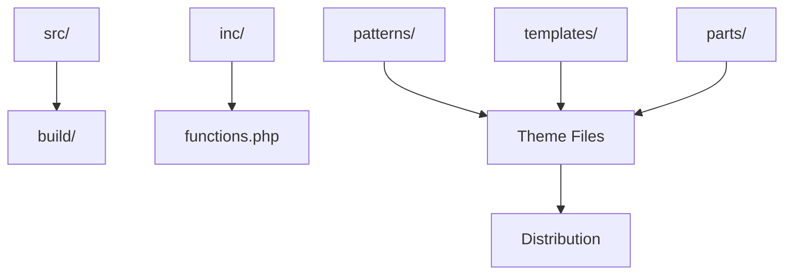

Quick start for {{theme_name}} development. See [docs/](docs/) for comprehensive guides.

## Setup

```bash
# Clone and install
npm install && composer install

# Start WordPress environment
npm run env:start
# Visit: http://localhost:8888

# Development mode
npm run start
```


## Architecture



**Key Folders:**

**Key Folders:**

- `src/` → Build source
- `inc/` → PHP code
- `patterns/` → Block patterns
- `tests/` → All tests


## Scripts

**Build:**

- `npm run start` - Dev mode + hot reload
- `npm run build` - Production build

**Quality:**

- `npm run lint` - All linters
- `npm run test` - All tests


## Testing

```bash
npm run test:unit    # JavaScript
composer run test    # PHP
npm run test:e2e     # End-to-end (after npm run env:start)
```


## Internationalization

```javascript
// JavaScript
__( 'Text', '{{theme_slug}}' )

// PHP
__( 'Text', '{{theme_slug}}' )
```


## Documentation

**Essential:**

- [docs/ARCHITECTURE.md](docs/ARCHITECTURE.md) - Structure
- [docs/BUILD_PROCESS.md](docs/BUILD_PROCESS.md) - Build system
- [docs/TESTING.md](docs/TESTING.md) - Test guide
- [docs/GOVERNANCE.md](docs/GOVERNANCE.md) - Policies

**All docs:** [docs/](docs/) directory

---

**{{theme_name}}** v{{version}} | [{{license}}]({{license_uri}})
