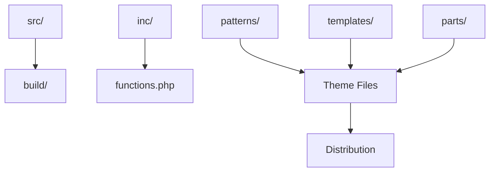

Quick start for {{theme_name}} development. See [docs/](docs/) for comprehensive guides.

## Setup

```bash
# Clone and install
npm install && composer install

# Start WordPress environment
npm run env:start
# Visit: http://localhost:8888

# Development mode
npm run start
```

npm 11 runs a package's install scripts only when `package.json` allows them (`allowScripts`). None of the theme's dependencies need theirs: the build uses prebuilt binaries, and the `prepare` script installs the git hooks. So `allowScripts` denies them, and `npm install` gives no warning. If a dependency you add needs its install script, allow it with `npm install-scripts approve <package>`.


## Architecture



**Key Folders:**

**Key Folders:**

- `src/` → Build source
- `inc/` → PHP code
- `patterns/` → Block patterns
- `tests/` → All tests


## Scripts

**Build:**

- `npm run start` - Dev mode + hot reload
- `npm run build` - Production build

**Quality:**

- `npm run lint` - All linters
- `npm run test` - All tests


## Testing

```bash
npm run test:unit    # JavaScript
composer run test    # PHP
npm run test:e2e     # End-to-end (after npm run env:start)
```


## Git hooks

`npm install` installs a pre-commit hook with [Lefthook](https://lefthook.dev/) (`lefthook.yml`), through the `prepare` script (`bin/hooks/install.cjs`). Outside a git checkout it does nothing, so run `npm install` again after `git init`. In order, the hook checks:

1. The branch has a type prefix such as `feat/` or `fix/`, and isn't `main`, `develop` or `release/*`.
2. A code change comes with a new `CHANGELOG.md` entry under `[Unreleased]`.
3. `npm run build` still works when `src/` changes.
4. The staged files pass the linters and the `theme.json` schema check. Fixes the linters make are staged.

Skip one check with `LEFTHOOK_EXCLUDE=build git commit`, or all of them with `git commit --no-verify`.


## Internationalization

```javascript
// JavaScript
__( 'Text', '{{theme_slug}}' )

// PHP
__( 'Text', '{{theme_slug}}' )
```


## Documentation

**Essential:**

- [docs/ARCHITECTURE.md](docs/ARCHITECTURE.md) - Structure
- [docs/BUILD_PROCESS.md](docs/BUILD_PROCESS.md) - Build system
- [docs/TESTING.md](docs/TESTING.md) - Test guide
- [docs/GOVERNANCE.md](docs/GOVERNANCE.md) - Policies

**All docs:** [docs/](docs/) directory

---

**{{theme_name}}** v{{version}} | [{{license}}]({{license_uri}})
